<div align="center">

# Security Investigation Agent

### 基于 LangGraph 的安全事件调查与模拟响应系统

**事件驱动 · 动态规划 · 证据溯源 · 规则评估 · 人工审批**

`Python 3.12–3.14` · `LangGraph` · `FastAPI` · `Streamlit` · `SQLite` · `Chroma`

</div>

> **项目边界**：仓库中的资产、日志、漏洞、IP 信誉与模拟 SIEM 事件均为合成演示数据。系统不会扫描主机、修改防火墙或连接真实工单系统；“封禁”和“创建工单”仅生成本地模拟结果。调查报告用于展示流程，不能直接作为生产环境的处置依据。

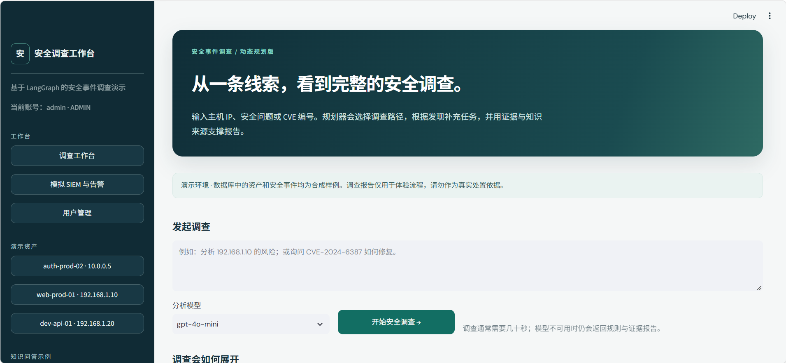

## 导航

[项目简介](#项目简介) · [系统架构](#系统架构) · [功能展示](#功能展示) · [快速开始](#快速开始) · [使用指南](#使用指南) · [实现细节](#实现细节) · [依赖版本](#技术栈与依赖版本) · [接口与数据](#接口与数据) · [验证](#验证与常见问题)

## 项目简介

Security Investigation Agent 面向安全运营的**调查环节**：输入主机 IP、安全问题或一条模拟 SIEM 告警，系统选择调查任务、收集证据、给出可复核的风险发现，并输出中文报告。

| 入口 | 示例 | 系统行为 |
| --- | --- | --- |
| 人工发起 | `请调查 192.168.1.10 最近是否有可疑活动` | 分析问题，规划资产、日志、漏洞和信誉等任务 |
| 事件触发 | 模拟生成 `SSH_FAILED_LOGIN` 事件 | 规则检测命中告警后，自动复用同一调查流程 |
| 知识问答 | `CVE-2024-6387 严重吗？如何修复？` | 聚焦安全知识检索，不查询无关的主机数据 |

**一次调查的产出**包括：风险等级与规则评分、证据编号与原始记录、MITRE ATT&CK 技术映射、Planner 任务计划、结构化执行轨迹、中文分析、可下载的 Markdown 报告，以及符合条件时的待审批模拟响应建议。

### 核心能力

| 能力 | 实现方式 | 界面位置 |
| --- | --- | --- |
| 动态 Planner | 模型生成结构化任务计划，程序校验任务和依赖；模型异常时规则回退 | 调查计划、任务执行轨迹 |
| 证据驱动补查 | 异常日志触发来源 IP 信誉和安全知识补查；漏洞记录触发知识补查 | 计划变化、完整轨迹 |
| 模拟 SIEM | 采集合成事件，由确定性规则产生告警并自动启动调查 | 模拟 SIEM 与告警 |
| 安全 RAG | Chroma 向量召回、关键词重排和本地回退；知识附来源 | 参考知识、检索模式 |
| 可解释风险 | 日志、漏洞、信誉、资产和历史由规则评分；证据不足返回“待确认” | 风险卡片、调查发现 |
| 技术映射 | 依据日志行为映射 ATT&CK 技术 | MITRE ATT&CK 技术映射 |
| 持久化运营 | 保存调查、告警、近 7 天资产历史、反馈和节点轨迹 | 最近调查、历史和轨迹 |
| Human in the loop | 受限响应方案通过 LangGraph `interrupt()` 等待审批 | 响应建议与审批 |
| 角色与规则管理 | 分析员、主管、管理员分权；管理员配置阈值和模拟工具开关 | 用户管理 |

> ATT&CK 映射表示行为与技术描述相符，**不等于证实入侵成功或完成攻击归因**。RAG 文档提供解释与缓解建议；具体主机风险仍由资产和日志等可验证证据决定。

## 系统架构

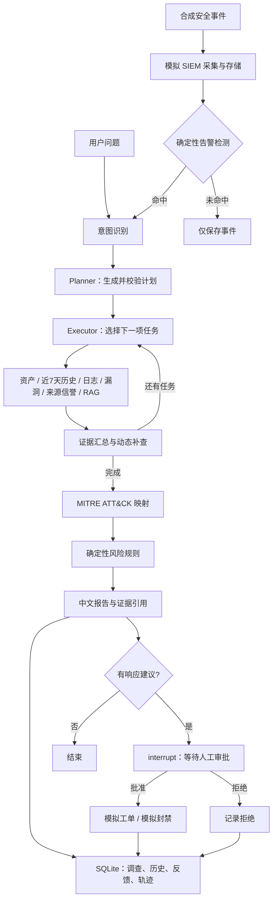

调查主图负责分析与报告；独立的响应图负责审批与模拟执行。模型参与规划和摘要生成；告警检测、风险评分、技术映射和响应条件由程序规则控制。

### Planner 如何因问题而变

| 输入 | 典型任务路径 | 原因 |
| --- | --- | --- |
| 调查 `192.168.1.10` 的近期风险 | 资产 → 历史 → 日志 → 按发现补查信誉、知识与漏洞 | 有明确主机，需核查资产证据 |
| `CVE-2024-6387 严重吗？怎么修复？` | 安全知识检索 | 无目标主机，不查询无关的资产和日志 |
| 某主机的 SSH 登录异常 | 资产 → 历史 → 日志 → 按日志补查信誉与知识 | 优先核实登录行为与来源 |

实际计划取决于输入、模型输出、计划校验和执行中的新证据。模型不可用时使用规则计划；前端会显示规划模式。

## 功能展示

以下截图来自仓库中的 `sercurity-agent/` 目录，展示的是当时的演示状态。实时结果会随数据库中的调查和管理员策略变化。

### 01 · 模拟事件自动进入调查

在左侧进入“模拟 SIEM 与告警”，选择事件、目标资产与模型，点击“生成事件并自动调查”。事件写入数据库后由规则检测；命中时生成告警、调查编号、报告和轨迹。

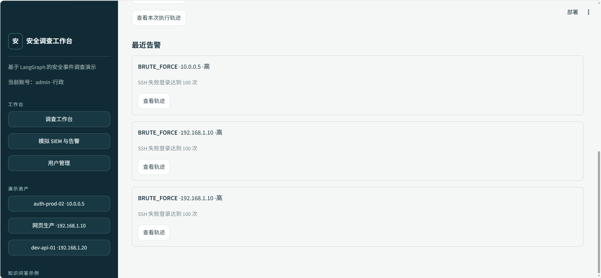

当前模拟器支持 `SSH_FAILED_LOGIN`、`PORT_SCAN`、`PRIVILEGE_ESCALATION`、`COMMAND_EXECUTION`、`MALWARE` 五类事件。SSH 和端口扫描阈值可由管理员调整。模拟器只生成记录，不执行攻击或网络探测。

### 02 · 不同问题选择不同路径

| 主机风险调查：多源证据 | CVE 问答：聚焦知识 |
| :---: | :---: |
| 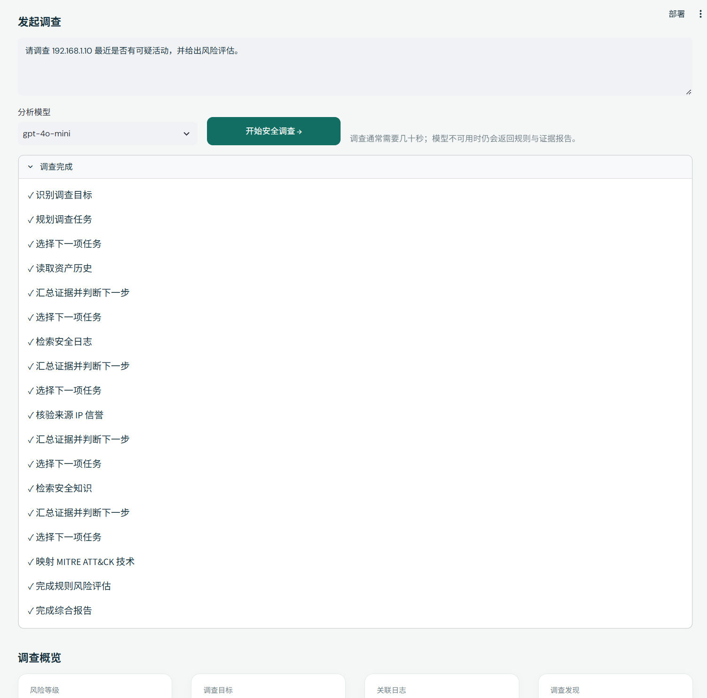 | 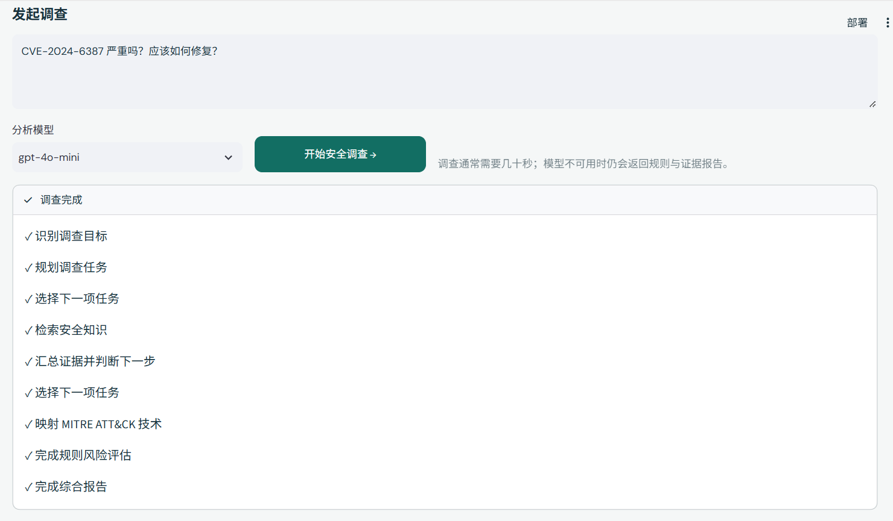 |

点击报告下方的“查看完整执行轨迹”，还可以逐步查看节点名称、事件类型、输入和输出摘要。轨迹不保存模型密钥或完整提示词。

### 03 · 从日志到可追溯结论

调查报告展示规则分数、发现、证据编号、参考知识、技术映射与原始记录。发现中的证据编号可与日志、漏洞、信誉或知识条目对应。

<details>
<summary><strong>展开：SSH 调查、MITRE 映射与原始证据</strong></summary>

<br>

**SSH 暴力破解调查概览**

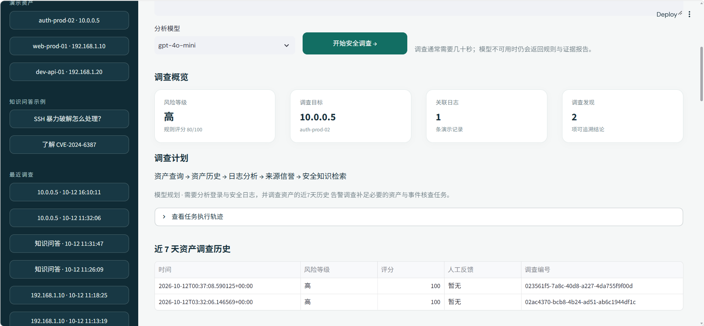

**MITRE 技术映射与原始证据**

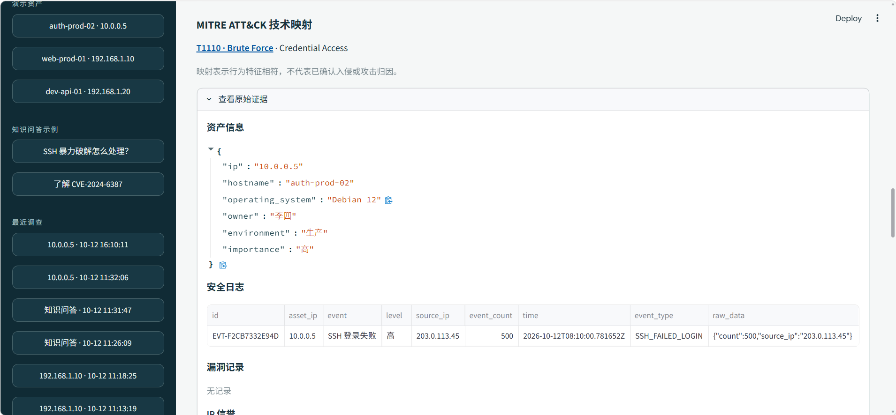

</details>

### 04 · 有来源的安全知识

本地知识库提供 CVE、攻击技术和事件响应指南。界面显示知识编号与来源 URL；检索结果用于解释和核查建议。

<details>
<summary><strong>展开：RAG 参考知识</strong></summary>

<br>

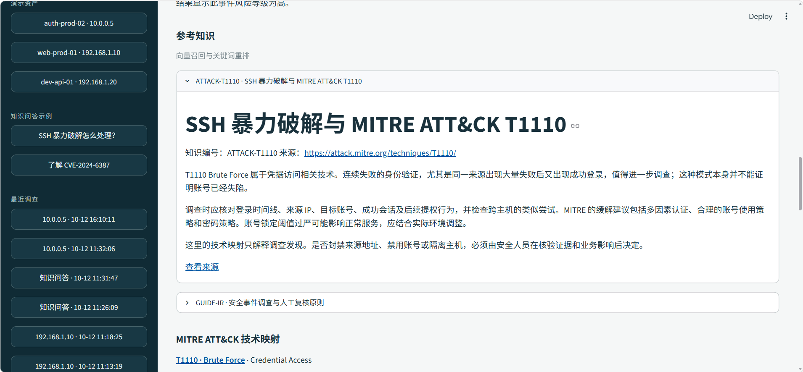

</details>

### 05 · 持久化历史、反馈与人工审批

具体资产的近 7 天调查历史会保存在 SQLite。分析员可标记“正确”“误报”“需要调整”，并写补充说明。反馈供后续人工优化，**不会自动训练模型或改写规则**。有响应建议时，主管或管理员可以批准或拒绝。

<details>
<summary><strong>展开：历史、反馈与模拟响应</strong></summary>

<br>

**近 7 天资产调查历史**

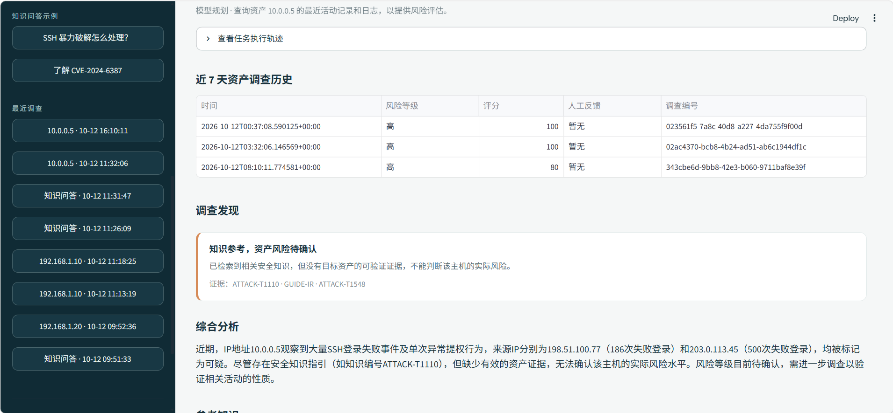

**人工反馈与待审批建议**


**批准后的本地模拟执行**

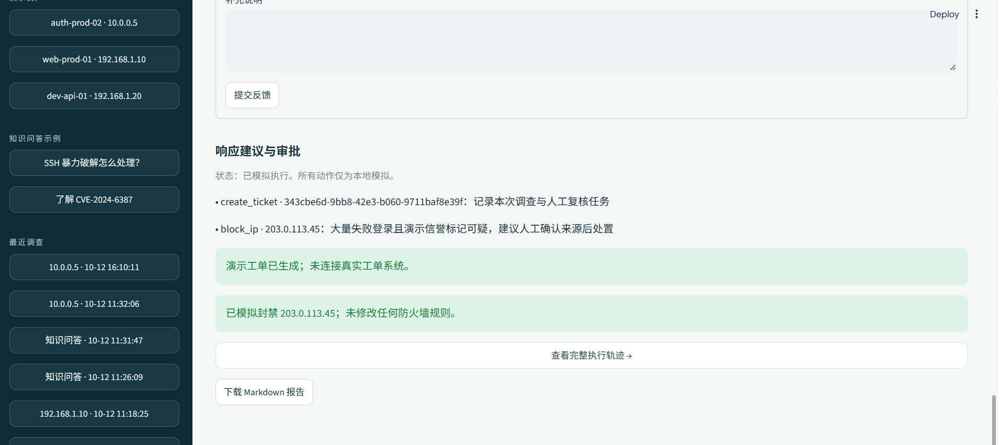

</details>

### 06 · 管理配置与报告导出

管理员在左侧“用户管理”创建账号、调整角色与启用状态，配置 SSH 和端口扫描阈值，以及模拟工具开关。调查报告可以下载为 Markdown 文件。

<details>
<summary><strong>展开：规则管理与下载报告</strong></summary>

<br>

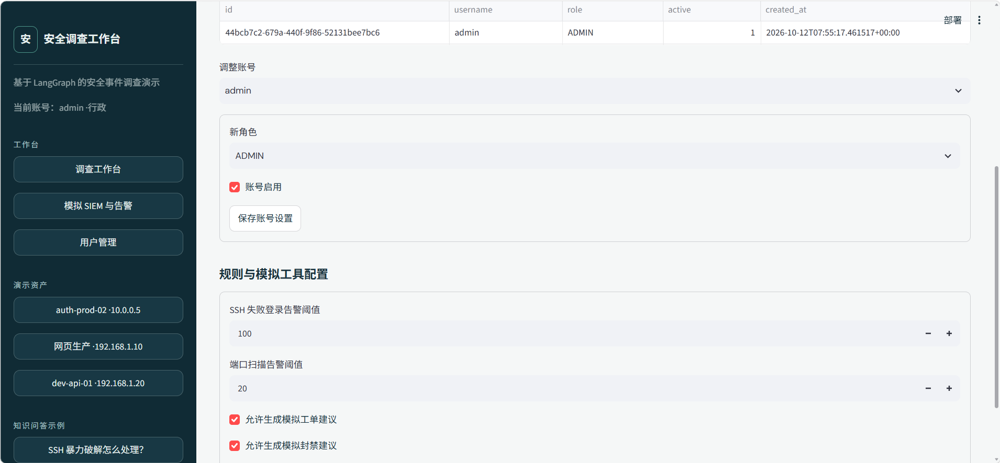

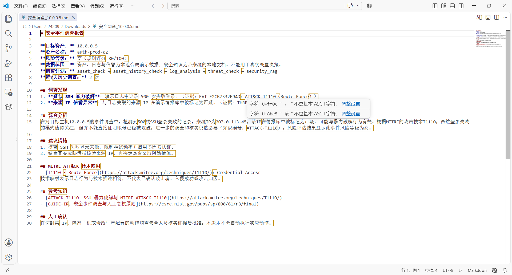

</details>

## 快速开始

以下命令在**项目根目录**执行。推荐 Python 3.12；项目元数据声明支持 Python `>=3.12,<3.15`。示例使用 Windows PowerShell，也可以直接在 PyCharm 终端运行。

### 1. 安装

```powershell
py -3.12 -m venv .venv
.\.venv\Scripts\python.exe -m pip install -e .
Copy-Item .env.example .env
```

项目依赖以 [`pyproject.toml`](pyproject.toml) 为准，[`requirements.txt`](requirements.txt) 保持相同的运行依赖约束。当前仓库**没有锁定文件**；`~=`、`>=` 代表允许范围，本机安装的补丁版本可能不同。

### 2. 配置模型

编辑本地 `.env`，选择一种运行方式。

**不调用外部模型，先验证本地流程：**

```dotenv
USE_FAKE_MODEL=true
SECURITY_RAG_MODE=lexical
```

**接入已配置的 OpenAI 兼容网关：**

```dotenv
USE_FAKE_MODEL=false
AIGCBEST_API_KEY=填写你自己的密钥
DEFAULT_MODEL=gpt-4o-mini
SECURITY_RAG_MODE=auto
```

也可以配置 `DEEPSEEK_API_KEY` 并设置 `DEFAULT_MODEL=deepseek-reasoner`；更多提供方选项见 [`.env.example`](.env.example)。前端可用模型列表来自后端 `/info`。密钥只放在本地环境配置，**不要提交到 GitHub**。

RAG 的 `auto` 模式在嵌入服务可用时尝试 Chroma 向量召回并做关键词重排；不可用时回退本地关键词检索。`lexical` 只用本地检索。嵌入模型使用 `AIGCBEST_API_KEY` 与 `AIGCBEST_EMBEDDING_MODEL`；仅配置 DeepSeek 密钥不会启用向量链路。

### 3. 初始化管理员

```powershell
.\.venv\Scripts\python.exe scripts\create_security_admin.py
```

按提示输入用户名和**至少 12 位**的密码；密码在终端隐藏输入。首次创建后，管理员可在“用户管理”中创建其他角色。已有安全账号时脚本会停止，避免重复初始化。仓库源码**没有内置 `admin/admin` 默认账号**。

### 4. 分别启动后端与工作台

打开两个终端：

```powershell
# 终端 A：FastAPI 后端，默认端口 8080
.\.venv\Scripts\python.exe src\run_service.py
```

```powershell
# 终端 B：Streamlit 工作台，示例端口 18501
.\.venv\Scripts\python.exe -m streamlit run src\streamlit_app.py --server.port 18501
```

| 地址 | 用途 |
| --- | --- |
| `http://127.0.0.1:18501` | 工作台与登录页 |
| `http://127.0.0.1:8080/health` | 后端健康检查，正常返回 `{"status":"ok"}` |
| `http://127.0.0.1:8080/docs` | FastAPI 交互式 API 文档 |

后端端口来自 `.env` 的 `PORT`，默认 8080；前端示例命令显式使用 18501。前后端分开部署时，在前端环境中设置 `AGENT_URL`，例如 `http://127.0.0.1:8080`。

### Docker Compose

完成 `.env` 配置及管理员初始化后，也可执行：

```powershell
docker compose up --build
```

Compose 默认把后端映射到宿主机 18080、工作台映射到 18501；可通过 `SECURITY_API_PORT`、`SECURITY_DASHBOARD_PORT` 调整。`data/` 与 `.runtime-tools/` 挂载到宿主机，保存业务数据库、JWT 密钥及审批检查点。当前 Dockerfile **没有复制管理员初始化脚本**，因此首次容器启动前需在宿主机按上文初始化，并与容器共用项目根目录下的 `data/`。

## 使用指南

### 路线 A：调查演示主机

1. 登录后点击左侧演示资产，或输入 `请调查 192.168.1.10 最近是否有可疑活动，并给出风险评估。`
2. 选择可用模型并点击“开始安全调查”；观察意图识别、规划、任务执行和报告进度。
3. 查看调查计划、发现、参考知识、MITRE 映射和原始证据。
4. 打开完整执行轨迹，检查节点输入/输出摘要，再下载 Markdown 报告。

### 路线 B：比较 Planner 路径

输入 `CVE-2024-6387 严重吗？应该如何修复？`。系统优先回答知识问题；没有主机证据时，风险结论为“待确认”，不会根据通用 CVE 文档直接认定某台资产受影响。

### 路线 C：模拟事件驱动调查

进入“模拟 SIEM 与告警”，选择“SSH 失败登录（500 次）”及目标资产，点击“生成事件并自动调查”。页面展示事件编号、告警、风险结果和轨迹入口。也可以选择端口扫描、提权、命令执行或恶意文件场景。

### 路线 D：完成人工审核

有响应建议的调查报告允许分析员提交反馈；`MANAGER` 或 `ADMIN` 可批准或拒绝模拟响应。批准只产生本地模拟结果和轨迹，**不会真实封禁 IP**。

## 实现细节

### Planner、Executor 与动态补查

Planner 只能选择六类任务：`asset_check`、`asset_history_check`、`log_analysis`、`vulnerability_check`、`threat_check`、`security_rag`。程序过滤不合法任务及无 IP 的资产任务，确保信誉查询有日志前置条件，并为具体资产补入近 7 天历史。Executor 依次选择节点；Evidence Collector 去重汇总证据，根据异常日志或漏洞结果追加后续任务。

### 模拟 SIEM 与告警

安全事件包含事件编号、时间、来源、目标 IP、类型、严重度及原始字段。采集器写入 SQLite；检测器按固定规则决定是否生成告警，例如 SSH 失败次数达到管理员配置的阈值时产生 `BRUTE_FORCE`。命中的告警携带目标资产和事件编号进入调查；未命中的事件仍会保存，不自动产生调查。

### RAG 与风险规则

知识文件在 [`knowledge/`](knowledge/)，包括 CVE 文档、SSH 暴力破解知识、响应指南和 ATT&CK 条目。文档切块时保留编号、标题、来源 URL 与文件路径；CVE 编号可精确匹配。普通问题可使用 Chroma 向量召回、关键词重排，也可使用本地关键词模式。

风险等级由 [`risk.py`](src/security/risk.py) 的确定性规则决定。SSH 登录失败、同源成功登录、提权、端口扫描、命令执行、漏洞、来源信誉和资产历史等因素参与评分，最终限制在 `0–100`；`>=70` 为高、`>=35` 为中，其余为低。资产或指定时段的证据不足时返回“待确认”。知识文档**不能单独证明目标主机受到攻击**。

### MITRE、报告和结构化轨迹

MITRE 映射依据明确的日志特征与 [`knowledge/mitre/`](knowledge/mitre/) 中的条目。报告把发现、证据编号、知识来源、技术映射和人工复核要求组织成 Markdown。轨迹按顺序记录 SIEM 采集、检测、Planner、Agent、证据汇总、评分、报告、审批和模拟工具的输入/输出摘要；原始证据单独展示。

### 角色、反馈和响应审批

| 角色 | 权限 |
| --- | --- |
| `ANALYST` | 登录、调查、查看轨迹与报告、提交人工反馈 |
| `MANAGER` | 分析员能力；批准或拒绝模拟响应 |
| `ADMIN` | 主管能力；管理账号、调整阈值与模拟工具设置 |

密码以带随机盐的 PBKDF2-SHA256 哈希保存；登录后使用 8 小时有效的 JWT。账号停用或角色调整后，后续请求会重新检查账号状态。受限响应列表允许中高风险建议模拟工单；只有 SSH 暴力破解且演示信誉达到条件时才建议模拟封禁来源 IP。独立响应图使用 SQLite 检查点和 LangGraph `interrupt()` 等待审批，审批人与结果会被保存。

## 技术栈与依赖版本

以下是 [`pyproject.toml`](pyproject.toml) 中声明的**版本约束**，不是所有机器的精确安装版本。`~=` 与 `>=` 的解析结果取决于安装时间、Python 版本和平台。

| 组件 | 声明的版本约束 | 用途 |
| --- | --- | --- |
| Python | `>=3.12,<3.15` | 运行环境；Docker 使用 Python 3.12 |
| LangGraph | `~=1.2.7` | 调查图、条件路由、审批中断与恢复 |
| LangGraph SQLite Checkpoint | `~=3.1.0` | 审批检查点持久化 |
| LangChain / LangChain Core | `~=1.3.11` / `~=1.4.8` | 模型消息与工具接口 |
| LangChain Text Splitters | `>=1.1.0` | 知识文档切分 |
| LangChain Chroma | `~=1.1.0` | 向量检索和本地索引 |
| LangChain OpenAI | `~=1.3.3` | OpenAI 兼容模型和嵌入 |
| FastAPI / Uvicorn | `~=0.141.0` / `~=0.52.0` | HTTP API 与 ASGI 服务 |
| Streamlit | `~=1.59.1` | 中文调查工作台 |
| Pydantic / Pydantic Settings | `~=2.13.4` / `~=2.15.0` | 数据结构与配置校验 |
| HTTPX | `~=0.28.1` | 工作台调用后端 |
| aiosqlite | `>=0.22.1` | 异步 SQLite 支持 |
| PyJWT | `>=2.10,<3` | 登录令牌 |
| python-dotenv | `~=1.2.2` | 本地环境变量 |

其他已声明的模型适配依赖：`langchain-anthropic~=1.4.8`、`langchain-aws~=1.6.1`、`langchain-google-genai~=4.2.6`、`langchain-google-vertexai>=3.2.4`、`langchain-groq~=1.1.3`、`langchain-ollama~=1.1.0`。开发依赖包括 `pytest`、`pytest-asyncio` 与 `ruff~=0.15.21`。

> 使用 `.\.venv\Scripts\python.exe -m pip freeze` 可查看**本机实际安装版本**。当前仓库没有依赖锁定文件；若需完全可复现的安装，需要另外维护锁定文件。

## 接口与数据

### 主要 API

除登录接口、`/health` 和 `/info` 外，安全业务接口需要登录令牌。完整请求和响应结构可在运行中的 `http://127.0.0.1:8080/docs` 查看。

| 方法 | 路径 | 用途 / 权限 |
| --- | --- | --- |
| `POST` | `/security/auth/login` | 登录并返回 Bearer Token |
| `GET` | `/security/auth/me` | 当前账号 |
| `GET/POST/PATCH` | `/security/auth/users`、`/security/auth/users/{username}` | 账号管理；管理员 |
| `GET/PATCH` | `/security/admin/policy` | 检测阈值与模拟工具；管理员 |
| `POST` | `/security/investigate` | 发起调查 |
| `POST` | `/security/investigate/stream` | SSE 调查步骤与结果 |
| `GET` | `/security/investigations`、`/security/investigations/{id}` | 调查列表与详情 |
| `GET` | `/security/investigations/{id}/trace` | 结构化执行轨迹 |
| `GET` | `/security/assets/{ip}/history` | 资产近 7 天历史 |
| `POST` | `/security/siem/simulate` | 生成合成事件并检测 |
| `POST` | `/security/siem/events` | 接收结构化事件并检测 |
| `GET` | `/security/siem/events`、`/security/siem/alerts` | 事件与告警列表 |
| `POST` | `/security/feedback` | 人工调查反馈 |
| `GET` | `/security/investigations/{id}/response` | 响应方案和状态 |
| `POST` | `/security/investigations/{id}/response/decision` | 批准或拒绝；主管/管理员 |

### 持久化内容

默认业务数据库为 `data/security_investigation.db`。若已有旧版 `data/security_demo.db`，项目会继续使用旧文件以保留账号和调查；可通过 `SECURITY_DB_PATH` 指定其他位置。

| 表或文件 | 保存内容 |
| --- | --- |
| `assets`、`security_logs`、`vulnerabilities`、`ip_reputation` | 本地合成数据 |
| `security_events`、`security_alerts` | 模拟 SIEM 事件与告警 |
| `investigations`、`agent_trace` | 调查结果与节点轨迹 |
| `asset_history`、`security_feedback` | 资产历史与人工反馈 |
| `security_users`、`security_policy` | 账号、角色与规则配置 |
| `response_plans` | 待审批建议、审批人与模拟结果 |
| `.runtime-tools/security_response_checkpoints.db` | LangGraph 审批检查点 |
| `.runtime-tools/security_jwt.key` | 单实例自动生成的 JWT 密钥；也可设置 `SECURITY_JWT_SECRET` |
| `.runtime-tools/security_chroma/` | 启用向量检索时的 Chroma 索引 |

这些运行时文件与 `.env` 已被 [`.gitignore`](.gitignore) 排除。公开仓库前仍应检查提交内容，避免包含密钥、个人数据或本地数据库。

### 目录结构

```text
.
├── src/
│   ├── security_dashboard.py        # Streamlit 中文工作台
│   ├── streamlit_app.py             # 前端入口
│   ├── run_service.py               # FastAPI 启动入口
│   ├── security/
│   │   ├── api.py                    # 调查、SIEM、轨迹和管理接口
│   │   ├── planner.py                # 结构化 Planner 与规则回退
│   │   ├── workflow.py               # LangGraph 调查主图
│   │   ├── risk.py / mitre.py        # 风险规则与技术映射
│   │   ├── repository.py             # SQLite 存储
│   │   ├── agents/                   # 历史与响应建议 Agent
│   │   ├── rag/                      # 知识加载与检索
│   │   ├── siem/                     # 事件生成、采集与检测
│   │   ├── response/                 # 人工审批与模拟工具
│   │   └── tools/                    # 资产、日志、漏洞、信誉、知识工具
│   └── service/                      # FastAPI 应用
├── knowledge/                        # CVE、攻击知识、指南、MITRE
├── scripts/create_security_admin.py  # 初始化管理员
├── tests/security/                   # 场景、权限、审批及界面测试
├── sercurity-agent/                  # 本 README 的功能截图
├── docs/Security_Investigation_V4.md
├── pyproject.toml
├── compose.yaml
└── .env.example
```

## 验证与常见问题

### 运行测试

```powershell
.\.venv\Scripts\python.exe -m pip install pytest pytest-asyncio
.\.venv\Scripts\python.exe -m pytest tests/security -q
```

测试覆盖规划、SIEM、风险与证据、反馈、权限、审批及工作台关键行为。本地验证可设置 `USE_FAKE_MODEL=true`，避免依赖外部模型服务。

### 常见问题

| 现象 | 检查方法 |
| --- | --- |
| 前端提示无法连接调查服务 | 确认后端运行且 `/health` 可访问；核对 `PORT` 与 `AGENT_URL` |
| 登录失败 | 确认已初始化账号、密码正确、账号未停用，且连接同一个数据库 |
| 没有预期模型 | 核对 `.env` 中的提供方密钥与 `DEFAULT_MODEL`，重启后端 |
| 向量检索未启用 | 核对 `AIGCBEST_API_KEY`、嵌入服务和 `SECURITY_RAG_MODE`；`auto` 会回退 |
| 有知识参考但风险“待确认” | 知识不能证明目标主机受影响；需资产和对应时段的证据 |
| 看不到“用户管理” | 只有 `ADMIN` 可见；`MANAGER` 可审批但不能配置账号和策略 |
| 批准后没有防火墙变化 | 这是预期行为；响应工具只返回本地模拟结果 |

更多设计细节见 [V4 设计文档](docs/Security_Investigation_V4.md)。

## 项目来源与许可

本项目早期服务框架基于 Joshua Carroll 的 [Agent Service Toolkit](https://github.com/JoshuaC215/agent-service-toolkit) 扩展；当前安全调查场景、模拟 SIEM、动态规划、风险规则、审批闭环与中文工作台为本项目实现。保留原项目的 [MIT 许可证](LICENSE)及版权声明。
