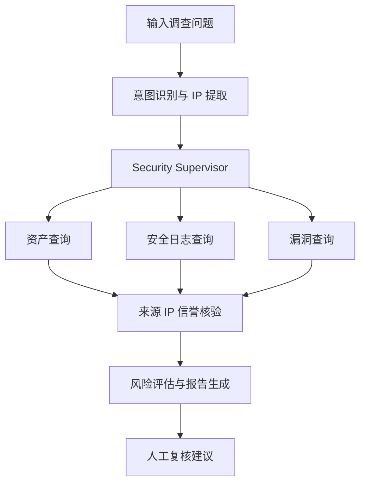

# 安全事件调查助手 V1

## 项目定位

这是安全事件调查系统的初期设计记录：安全人员输入目标服务器 IP，系统查询本地合成资产、日志、漏洞和 IP 信誉，给出可追溯的风险报告。当前完整功能与运行方式以 [README](../README.md) 和 [V4 文档](Security_Investigation_V4.md) 为准。

当前数据全部是**合成演示数据**。报告仅用于展示调查流程，不代表真实安全事件，也不能直接作为生产处置依据。

## V1 业务流程



`SecurityState` 在节点之间传递目标 IP、资产资料、日志、漏洞、来源 IP 信誉、发现和报告。资产、日志、漏洞查询可并行执行；信誉查询使用日志里的**来源 IP**，不会把目标服务器 IP 当成外部威胁来源。风险等级由确定性规则和证据编号生成，模型只撰写补充摘要。模型网关不可用时，仍会返回规则报告。

## 代码位置

| 模块 | 位置 | 作用 |
| --- | --- | --- |
| 状态与工作流 | `src/security/state.py`、`src/security/workflow.py` | LangGraph 节点及共享状态 |
| 工具 | `src/security/tools/` | 资产、日志、漏洞、IP 信誉查询 |
| 演示数据 | `src/security/demo_data.py`、`src/security/repository.py` | SQLite 建表、种子数据和调查记录 |
| 风险规则 | `src/security/risk.py` | 风险评分、证据关联与报告骨架 |
| API | `src/security/api.py` | 调查、流式进度、历史、演示资产接口 |
| 前端 | `src/security_dashboard.py` | 调查工作台和报告展示 |

数据库默认生成在项目根目录 `data/security_demo.db`；可以用 `SECURITY_DEMO_DB_PATH` 指定其他路径。它与原项目的 LangGraph 检查点数据库彼此独立。漏洞编号使用 `DEMO-VULN-*`，不冒充真实 CVE；外部来源 IP 使用文档示例地址段。

## 启动与体验

先确认项目根目录的 `.env` 已配置至少一个可用模型。Windows / PyCharm 中，将项目解释器设置为 `.venv\Scripts\python.exe`，两个运行配置的工作目录都设为项目根目录。

1. 运行 `src/run_service.py`，启动 FastAPI 后端。后端端口读取 `.env` 的 `PORT`。
2. 运行 `src/streamlit_app.py`，启动 Streamlit 前端。前端端口读取 `STREAMLIT_PORT`。
3. 打开 `http://127.0.0.1:18501`。点击左侧演示资产，或输入“请调查 192.168.1.10 最近是否有可疑活动”，然后点击“开始安全调查”。
4. 查看节点进度、风险等级、发现、原始证据和中文报告。报告可下载为 Markdown。

如 `.env` 的 `PORT` 不是 `18080`，前端会自动读取它；前后端分开部署时设置 `AGENT_URL=http://后端地址:端口`。当前版本的安全接口使用 JWT 登录，权限说明以 V4 文档为准。

### 直接从终端运行

在项目根目录分别打开两个 PowerShell 终端：

```powershell
.\.venv\Scripts\python.exe src\run_service.py
```

```powershell
.\.venv\Scripts\python.exe src\streamlit_app.py
```

### 结构化 API

| 方法 | 路径 | 用途 |
| --- | --- | --- |
| `GET` | `/security/demo-assets` | 可体验的演示资产 |
| `POST` | `/security/investigate` | 一次性返回调查结果 |
| `POST` | `/security/investigate/stream` | SSE 逐步返回节点进度和报告 |
| `GET` | `/security/investigations` | 最近调查 |
| `GET` | `/security/investigations/{id}` | 某次调查的完整结果 |

请求示例：

```json
{"query":"请调查 192.168.1.10 最近是否存在异常登录风险","model":"gpt-4o-mini"}
```

API 文档位于 `http://127.0.0.1:18080/docs`（按实际 `PORT` 调整）。

## 当前边界与后续扩展

V1 采用 SQLite 演示数据，不连接真实资产库、SIEM 或威胁情报服务；没有自动封禁、隔离主机、创建工单等响应动作。对未知 IP 返回“待确认”，不会编造调查发现。下一阶段可以替换数据查询工具，加入安全知识检索与工单审批，并保持现有 `SecurityState` 和 API 契约。
