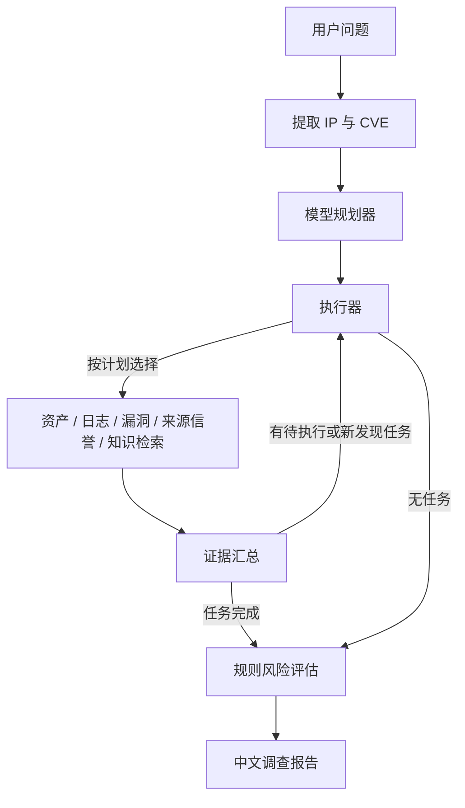

# 安全事件调查助手 V2

## 目标和使用方式

V2 在 V1 的演示资产、日志、漏洞和规则报告上加入动态规划和安全知识检索。用户可以输入主机风险问题、登录异常问题，或纯 CVE / 安全知识问题。模型先从五种受控任务中选择所需步骤；执行结果可以触发补查。风险等级仍由规则和证据决定，模型负责规划与文字解读。

当前资产、日志、漏洞和 IP 信誉都是本地合成演示数据。知识库中的 MITRE ATT&CK、NVD 和 NIST 内容是简短的中文摘录，附有官方来源；它不能替代实时漏洞情报或生产环境检测。

## 工作流



规划器的任务白名单为 `asset_check`、`log_analysis`、`vulnerability_check`、`threat_check` 和 `security_rag`。模型返回 JSON 计划，代码校验、去重和处理依赖；模型不可用时使用关键词规则回退。执行器一次运行一个任务，便于根据前一步结果改变后续路径。日志有来源 IP 时可追加信誉核验；发现 SSH 暴力破解或异常提权线索时可追加知识检索；发现漏洞记录也可补查知识。不会由模型直接执行系统命令或处置主机。

输入示例：

| 输入 | 预期路径 |
| --- | --- |
| `分析一下192.168.1.10最近有没有攻击风险` | 资产、日志等调查任务；按发现补查信誉和知识 |
| `CVE-2024-6387漏洞严重吗？怎么修复？` | 只查对应 CVE 知识，主机风险保持“待确认” |
| `为什么192.168.1.10昨天凌晨登录异常？` | 查询该时间段日志；若演示数据没有对应日期，报告明确说明无法判断 |
| `SSH暴力破解怎么处理？` | 查询 ATT&CK 和安全规范，不假定某台主机已经受攻击 |

## 知识检索

知识文档位于项目根目录的 `knowledge/`，目前按 `attack/`、`cve/`、`guideline/` 分类。每份文档包含知识编号、标题、来源网址和正文。`src/security/rag/loader.py` 读取并分块；`src/security/rag/retriever.py` 用配置的 `text-embedding-3-small` 和 Chroma 建立本地索引，召回后结合关键词重排。默认 `SECURITY_RAG_MODE=auto`，向量服务不可用时退回本地关键词检索；首次向量检索会建立索引。`SECURITY_RAG_MODE=lexical` 可以离线运行。精确 CVE 查询只返回同编号文档，知识库里没有的 CVE 会明确显示无匹配资料。

可以在 `.env` 中设置 `SECURITY_KNOWLEDGE_DIR` 和 `SECURITY_VECTOR_DB_PATH` 修改文档与索引位置。添加或更新知识文档后，索引按文档内容重新同步。密钥保存在 `.env`，知识文档不要包含密钥或私人调查数据。

## 代码位置

| 文件 | 作用 |
| --- | --- |
| `src/security/state.py` | 计划、当前任务、完成任务、证据和知识等共享状态 |
| `src/security/planner.py` | 模型规划、任务校验与回退 |
| `src/security/workflow.py` | LangGraph 执行器、任务节点、补查与报告节点 |
| `src/security/rag/`、`src/security/tools/knowledge.py` | 文档读取、向量检索、关键词回退与工具封装 |
| `src/security/risk.py` | 确定性风险规则及带来源的报告 |
| `src/security/api.py` | 调查、流式进度、历史接口及 V2 结果字段 |
| `src/security_dashboard.py` | 工作台、计划轨迹、知识引用与报告展示 |
| `tests/security/test_investigation.py` | 主机调查、知识问答、动态补查和时间范围测试 |

## 运行

在项目根目录的 `.env` 配置已有模型网关密钥及默认模型。Windows / PyCharm 使用项目的 `.venv\Scripts\python.exe` 作为解释器，两个运行配置的工作目录都设为项目根目录。先启动后端，再启动前端：

```powershell
.\.venv\Scripts\python.exe src\run_service.py
```

```powershell
.\.venv\Scripts\python.exe src\streamlit_app.py
```

打开 `http://127.0.0.1:18501`（以 `.env` 的 `STREAMLIT_PORT` 为准）。页面可点示例问题，也可输入自己的问题。后端接口为 `POST /security/investigate` 和 `POST /security/investigate/stream`；API 文档地址为 `http://127.0.0.1:18080/docs`（以 `PORT` 为准）。修改后端代码后需重启后端；若前端未自动更新，也重启前端。测试命令：

```powershell
.\.venv\Scripts\python.exe -m pytest -q tests\security
```

## 数据存储与边界

`data/security_demo.db` 存放演示资产、日志、漏洞、来源信誉和调查历史，独立于原项目的 LangGraph 检查点。`.runtime-tools/security_chroma/` 存放本地知识向量索引。文档原文在 `knowledge/`。调查历史会保留查询与报告；不要在演示环境输入真实敏感事件。没有资产或指定时间段日志时，报告保持“待确认”；知识资料只提供解释，不作为资产受影响或事件已发生的证据。系统目前没有连接 SIEM、真实威胁情报或自动处置接口。
