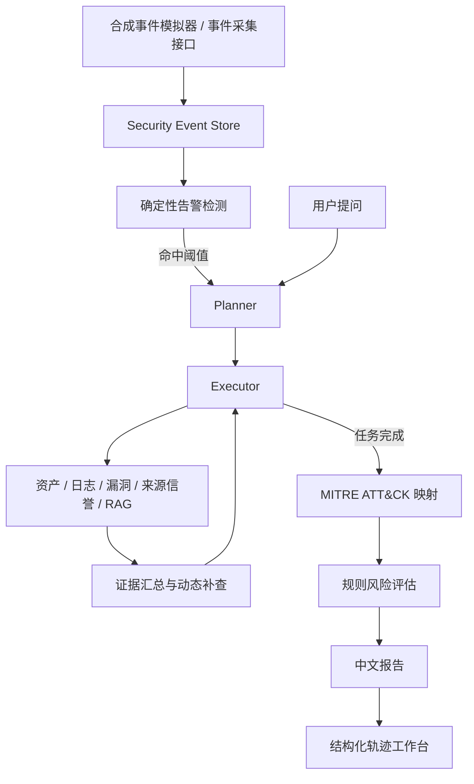

# 安全事件调查助手 V3

## 系统定位

V3 在 V2 动态规划调查的基础上加入模拟 SIEM 事件入口、确定性告警检测、MITRE ATT&CK 技术映射和结构化执行轨迹。手动提问与自动告警共用同一个 LangGraph 调查工作流。

所有事件和资产数据都是合成样例。事件模拟器**只写入事件记录**，不会向目标主机发起登录、扫描或其他操作。MITRE 映射表示日志行为与技术描述相符，不代表真实入侵或攻击归因。



## 模拟 SIEM

`src/security/siem/schema.py` 定义事件与告警；`event_generator.py` 生成 SSH 失败登录、端口扫描、sudo 提权、命令解释器执行和恶意文件特征五类合成事件。`collector.py` 将事件写入 SQLite，`detector.py` 根据可解释阈值生成告警。命中告警后自动调用已有 Planner 和工作流。事件编号相同且内容相同的重复请求不会重复调查；编号相同而内容不同返回冲突。

告警调查的日志节点只读取**触发这次告警的事件**，以免混入该资产原有的演示日志。手动调查仍可查询资产的完整演示日志。模型可以选择额外任务，但告警调查必有资产和事件日志核查；SSH 暴力破解告警还会核查来源信誉与安全知识。

## MITRE ATT&CK 与知识检索

`knowledge/mitre/` 保存技术编号、名称、战术、检测思路、缓解建议和官方来源。`src/security/mitre.py` 只在证据满足明确条件时映射：大量 SSH 失败登录关联 T1110；带解释器类型的命令执行关联 T1059；带 `sudo` 方法的提权事件关联 T1548。仅有笼统的“异常提权”记录不会被强行映射到 T1548。技术信息附在风险发现中，并显示在报告和工作台上。

这些技术资料也会进入已有的安全知识检索流程，供报告生成时解释检测和缓解方向。官方资料：[T1110 Brute Force](https://attack.mitre.org/techniques/T1110/)、[T1059 Command and Scripting Interpreter](https://attack.mitre.org/techniques/T1059/)、[T1548 Abuse Elevation Control Mechanism](https://attack.mitre.org/techniques/T1548/)。

## 执行轨迹

`agent_trace` 表按调查编号和顺序保存节点名、事件类型、输入摘要、输出摘要和时间。摘要包含计划、证据编号、日志计数、技术编号、规则评分等排障信息；不保存模型原始提示、密钥或知识全文。模拟 SIEM 调查的轨迹从采集、告警检测开始，随后记录每个 LangGraph 节点。旧版调查记录保留，但因创建时未采集节点轨迹，轨迹页会提示没有数据。

前端“查看完整执行轨迹”进入时间线页面；`GET /trace/{调查编号}` 会跳转到该页面。前后端不在同一台机器时，可设置 `SECURITY_FRONTEND_URL` 指定跳转地址。结构化数据也可以通过 `GET /security/investigations/{调查编号}/trace` 获取。V3 沿用 Streamlit 页面，不引入单独的 React 构建和部署流程。

## 本地运行与体验

使用项目根目录的 `.env` 配置模型网关。分别启动后端和前端：

```powershell
.\.venv\Scripts\python.exe src\run_service.py
```

```powershell
.\.venv\Scripts\python.exe src\streamlit_app.py
```

打开 `http://127.0.0.1:18501`，侧栏进入“模拟 SIEM 与告警”，选择资产和事件场景，点击“生成事件并自动调查”。结果页可查看风险报告和完整执行轨迹。API 文档默认位于 `http://127.0.0.1:18080/docs`，端口以 `.env` 为准。

主要接口：

| 方法 | 路径 | 作用 |
| --- | --- | --- |
| `POST` | `/security/siem/simulate` | 生成合成事件并在命中告警后自动调查 |
| `POST` | `/security/siem/events` | 接收结构化事件并执行同一采集与检测流程 |
| `GET` | `/security/siem/events` | 查看事件库 |
| `GET` | `/security/siem/alerts` | 查看告警与关联调查 |
| `POST` | `/security/investigate` | 手动调查 |
| `POST` | `/security/investigate/stream` | 流式调查进度 |
| `GET` | `/security/investigations/{id}/trace` | 获取节点轨迹数据 |
| `GET` | `/trace/{id}` | 打开可视化轨迹页 |

模拟请求示例：

```json
{"scenario":"SSH_FAILED_LOGIN","asset_ip":"192.168.1.10","model":"gpt-4o-mini"}
```

SQLite 默认文件为 `data/security_demo.db`，新增 `security_events`、`security_alerts` 和 `agent_trace` 三张表。向量索引仍在 `.runtime-tools/security_chroma/`。真实 SIEM 连接、持续消费队列、实时情报和自动响应不在当前模拟范围内。
