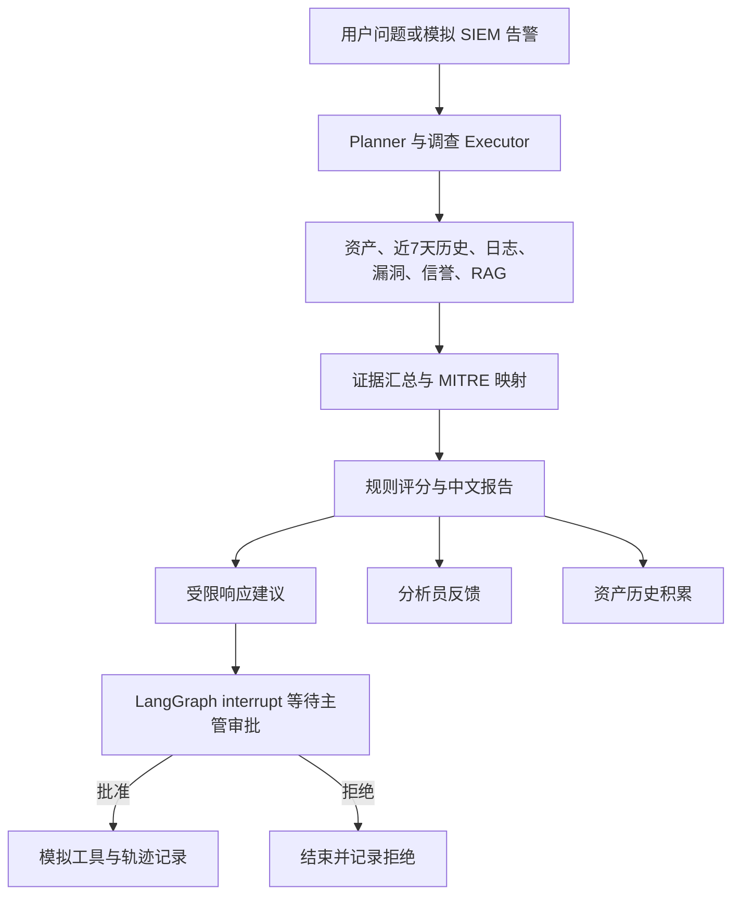

# 安全事件调查助手 V4：持续运营闭环

V4 沿用 V3 的 LangGraph 调查、模拟 SIEM、MITRE 映射、规则风险评估与轨迹页面，新增资产历史、人工反馈、账号角色和人工审批的模拟响应。所有资产、事件、信誉及响应结果仍是演示数据。



## 首次运行

在项目根目录设置 Python 解释器并创建管理员。密码会在终端隐藏输入，不会通过网络传输：

```powershell
.\.venv\Scripts\python.exe scripts\create_security_admin.py
```

随后在两个终端分别启动：

```powershell
.\.venv\Scripts\python.exe src\run_service.py
```

```powershell
.\.venv\Scripts\python.exe src\streamlit_app.py
```

打开 `http://127.0.0.1:18501` 登录。管理员可在“用户管理”页面创建分析员和主管账号，调整角色、停用账号，并配置演示告警阈值与模拟工具开关。

安全工作台使用独立的 8 小时 JWT。`.env` 中可设置 `SECURITY_JWT_SECRET`；本地单实例留空时，首次登录会在被 Git 忽略的 `.runtime-tools/security_jwt.key` 生成密钥。多实例部署必须提供相同且足够强的密钥。

## 资产历史

每次完成具体资产调查后，`asset_history` 保存资产 IP、调查编号、风险等级、分数、发现及时间。V3 已有的调查会在首次访问数据库时补入历史。`history_agent` 查询近 7 天历史，并作为可追溯证据进入报告。当前调查有风险分且近 7 天已有至少三次调查时，规则加 10 分；最近三次分数严格递增时再加 15 分。历史趋势不能单独证明当前攻击；用户反馈也不会自动重写历史或训练模型。

## 反馈与权限

分析员可对一次调查标记“正确”“误报”或“需要调整”，添加说明。每名分析员对同一调查保留一条可更新的反馈。反馈保存在 `security_feedback` 表，供后续人工调整提示、规则和知识库；本版不会自动训练或自动改规则。

| 角色 | 能力 |
| --- | --- |
| `ANALYST` | 查看与发起调查、查看报告和轨迹、提交反馈 |
| `MANAGER` | 分析员能力；审批或拒绝模拟响应 |
| `ADMIN` | 主管能力；管理账号、配置检测阈值与模拟工具开关 |

密码使用带随机盐的 PBKDF2-SHA256 哈希保存。令牌由账号实时状态校验：停用或降级后，新请求立即按新权限处理。真实生产环境还需要外部身份服务、集中审计和登录限流。

## 响应审批

响应建议由固定允许列表产生：中高风险创建演示工单；只有 SSH 暴力破解且演示来源信誉达到条件时才建议模拟封禁 IP。`response_plans` 保存建议和审批人。独立响应 LangGraph 用 SQLite 检查点和 `interrupt()` 等待人工决定，因此服务重启后可继续审批。只有主管或管理员可以批准；拒绝会结束流程。批准后工具只返回“模拟完成”结果和演示工单编号，**不会访问防火墙、主机或真实工单系统**。方案只允许处理一次。

## 主要接口

| 方法 | 路径 | 权限 |
| --- | --- | --- |
| `POST` | `/security/auth/login` | 公开登录 |
| `GET` | `/security/auth/me` | 已登录 |
| `GET/POST/PATCH` | `/security/auth/users`、`/security/auth/users/{username}` | 管理员 |
| `GET/PATCH` | `/security/admin/policy` | 管理员 |
| `GET` | `/security/assets/{ip}/history` | 已登录 |
| `POST` | `/security/feedback` | 已登录 |
| `GET` | `/security/investigations/{id}/feedback` | 已登录 |
| `GET` | `/security/investigations/{id}/response` | 已登录 |
| `POST` | `/security/investigations/{id}/response/decision` | 主管或管理员 |

调查、SIEM、报告与轨迹接口需要登录取得的 JWT。OpenAPI 文档位于后端 `/docs`，实际端口以 `.env` 为准。新安装的数据库默认位于 `data/security_investigation.db`；若旧版的 `data/security_demo.db` 已存在，系统会继续使用它以保留数据。也可设置 `SECURITY_DB_PATH` 指定路径。响应图检查点位于 `.runtime-tools/security_response_checkpoints.db`。
